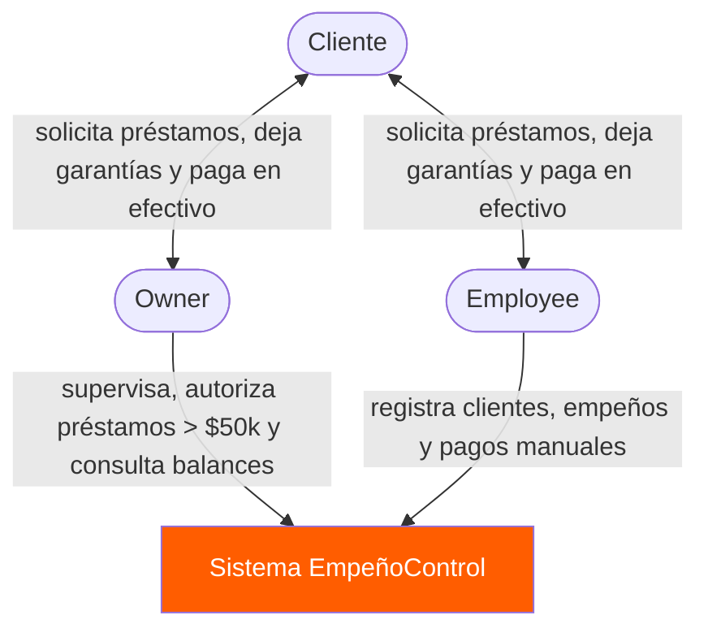
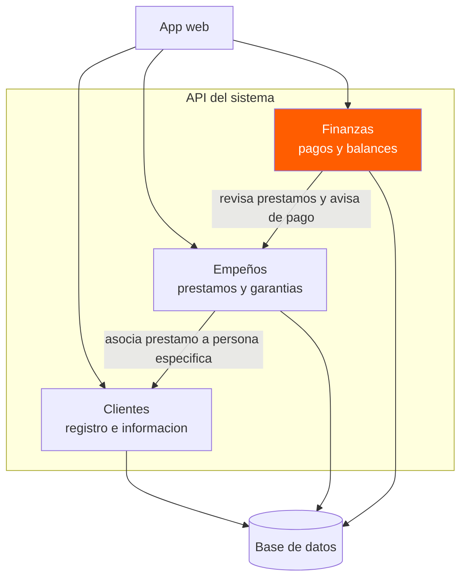

``` mermaidflowchart TD
    owner([Owner])
    emp([Employee])

    subgraph sistema[Sistema EmpeñoControl]
        web[App web<br/>React]
        api[API Monolito Modular<br/>Node.js]
        db[(Base de datos<br/>PostgreSQL)]
    end

    owner -->|usa| web
    emp -->|usa| web
    web -->|HTTPS/JSON| api
    api -->|lee y escribe| db

    style api fill:#ff5d00,color:#fff
```



